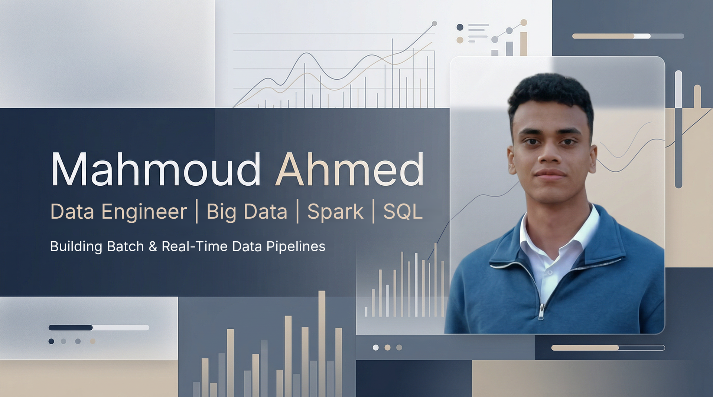

  

<h1 align="center">Mahmoud Ahmed</h1>
<h3 align="center">Data Engineer | Big Data | Batch & Streaming Pipelines</h3>

  
  
  

  

---

## 👨‍💻 About Me

I'm **Mahmoud Ahmed**, a **Data Engineer** and a **Computer Science & Artificial Intelligence undergraduate** at **Cairo University**.
I build **batch and real-time data pipelines**, **big data processing** solutions, and **data warehouses** that turn raw data into reliable, analytics-ready datasets.

* 🎓 CS & AI student at **Cairo University** (Expected 2027)
* ⚙️ Focused on **Data Engineering** and **Big Data**: Spark, Hadoop, Hive, Kafka, Airflow
* 🌊 Hands-on with **real-time streaming**: CDC with Debezium, Spark Structured Streaming, Microsoft Fabric
* 🏛️ Experienced in **data modeling**: Star / Galaxy Schema, SCD Type 2, Medallion Architecture
* 📊 Background in **BI & Data Analysis** with Power BI, so I build pipelines with the end user in mind

---

## 💼 Experience

### Big Data Trainee — Samsung Innovation Campus
**Jul 2026 – Nov 2026**
* Hands-on experience with **Hadoop, HDFS, Hive, Sqoop, Apache Spark, and PySpark** for distributed data processing
* Applied data ingestion, transformation, validation, data warehousing, and dimensional modeling through practical tasks and capstone projects

### Microsoft Data Engineer Track Trainee — DEPI
**Jul 2026 – Nov 2026**
* Practical training in **data engineering, data integration, ETL/ELT workflows**, and Microsoft data platform technologies
* Hands-on tasks covering data ingestion, transformation, storage, modeling, and end-to-end data workflows

### Microsoft Power BI Specialist Track Trainee & Team Leader — DEPI
**Jun 2025 – Dec 2025**
* Training in data preparation, dimensional modeling, **Power Query, DAX, and Power BI**
* Led a student team, coordinated task distribution, and helped ensure timely project delivery

---

## 🧰 Tech Stack

**Big Data & Streaming**

  
  
  
  
  
  
  
  

**Pipelines, Warehousing & Cloud**

  
  
  
  
  
  
  
  
  
  
  
  

**Languages & Databases**

  
  
  
  
  
  
  
  
  

**DevOps, Monitoring & Visualization**

  
  
  
  
  
  
  
  

---

## 🚀 Featured Projects

### 🌊 Retail Clickstream IQ — Real-Time E-Commerce Analytics Platform
`PostgreSQL` `Debezium` `Azure Event Hubs` `Spark Structured Streaming` `Microsoft Fabric` `Delta Lake` `Streamlit` `Power BI`
* Lambda-style platform combining **batch and real-time processing** over a shared **Medallion Lakehouse** (Bronze, Silver, Gold) for 42M+ clickstream events
* Streamed database changes with **Debezium CDC** through **Azure Event Hubs** into **Spark Structured Streaming**, with validation, deduplication, and idempotent Delta MERGE writes
* **Dead Letter Queue** with replay and per-batch reconciliation (1M+ messages, zero data loss)
* Per-minute KPIs served on a **real-time Streamlit dashboard** and **Power BI** reports

🔗 [View Repository](https://github.com/MahmoudAhmed150/Retail-Clickstream-Pipeline)

---

### 🛒 E-Commerce Batch Data Pipeline — Samsung Innovation Campus Capstone
`MariaDB` `Sqoop` `HDFS` `PySpark` `Hive`
* End-to-end batch pipeline: **MariaDB → Sqoop → HDFS → Spark → Hive**
* Organized data into **Bronze, Silver, and Gold** layers and used **PySpark** for cleaning, validation, and transformation
* Built analytics-ready **Fact and Dimension tables (Star Schema)** exposed through Hive

🔗 [View Repository](https://github.com/MahmoudAhmed150/ecommerce-batch-data-pipeline)

---

### 🏛️ BikeStore End-to-End Data Warehouse
`SQL Server` `SSIS` `SQL Server Agent` `Power BI`
* **Galaxy Schema** data warehouse with 3 fact tables and 6 dimension tables
* ETL pipelines (**OLTP → STG → DWH**) with SSIS, **SCD Type 2**, and automated daily runs
* Power BI dashboard analyzing **$7.69M+** sales revenue

🔗 [View Repository](https://github.com/MahmoudAhmed150/BikeStore-DataWarehouse-ETL)

---

### 🐳 DataOps Spark Lab
`PySpark` `Pytest` `Docker` `GitHub Actions`
* PySpark pipeline with automated tests, containerization, and **CI/CD** using GitHub Actions

🔗 [View Repository](https://github.com/MahmoudAhmed150/DataOps-Sparl-Lab)

---

### 🛡️ Car Insurance Company System
`SQL Server` `C#` `ERD`
* Normalized relational database (**3NF**) with 8+ tables and a C# app for CRUD operations

🔗 [View Repository](https://github.com/MahmoudAhmed150/Car-Insurance-System)

---

### 📊 Earlier Data Analysis Projects
* [US Accidents Analysis (2016–2023)](https://github.com/MahmoudAhmed150/DEPI-Graduation-Project-US-Accidents-2016-2023) — DEPI graduation project, Power BI & DAX
* [Market Data Analysis](https://github.com/MahmoudAhmed150/Market-Data-Analysis)
* [Pharma Sales Analysis](https://github.com/MahmoudAhmed150/Pharma-sales-analysis)

---

## 🏆 Highlights

* ⚙️ Data Engineer building **batch and real-time pipelines** on Spark, Hadoop, and Microsoft Fabric
* 🎓 CS & AI undergraduate at **Cairo University**
* 🧪 Samsung Innovation Campus (Big Data) & DEPI (Microsoft Data Engineer) trainee
* 👨‍🏫 Team Leader in **DEPI**

---

## 📈 GitHub Analytics

  
  &nbsp;&nbsp;
  

  

---

## 🤝 Connect With Me

  
  

---

  <b>Building reliable data platforms, one pipeline at a time ⚙️</b>

